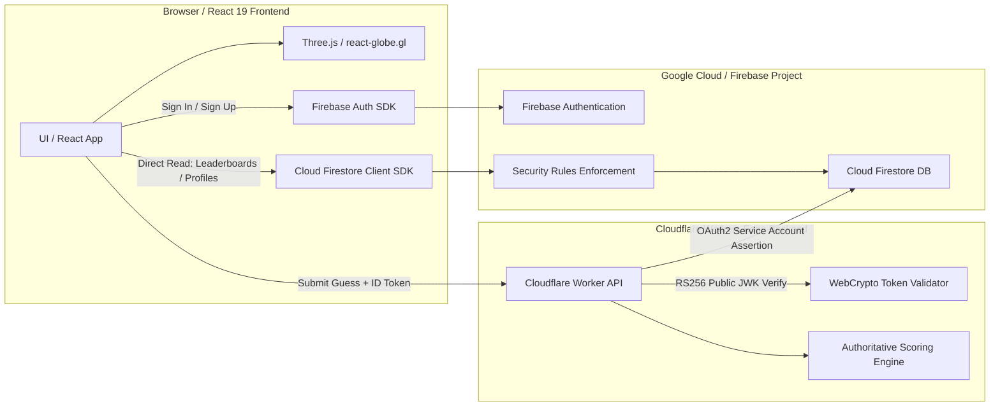

# Globe Detective 🕵️‍♂️🌍

[](https://github.com/Gargi016/globe-detective)
[](https://www.typescriptlang.org/)
[](https://react.dev/)
[](https://vitejs.dev/)
[](https://workers.cloudflare.com/)
[](https://firebase.google.com/)
[](https://creativecommons.org/licenses/by-nc-sa/4.0/)

An interactive educational web app for dating vintage globes by their territorial borders and place names. Explore historical boundaries from **1886 to 2019** on a 3D globe, investigate clues step-by-step, compete in daily "guess the year" challenges, and climb the global leaderboards.

---

## 🌟 Features

| Mode / View | Route | Description |
|---|---|---|
| **3D Globe Explorer** | `#/` | Interactive 3D Earth with modern borders, country search, and geopolitical inspector. |
| **Historical Timeline** | `#/timeline` | Time-travel across every border shift from 1886–2019 with territory status, entity cards, and shareable deep links. |
| **Detective Mode** | `#/detective` | Interactive case desk: record observations (e.g. "Rhodesia exists", "Germany partitioned") to compute an authoritative date range with confidence scoring and contradiction analysis. |
| **Challenge Mode** | `#/challenge` | Daily and practice mystery globes. Guess the historical year span, earn distance-based points, manage hints, and maintain daily streaks. |
| **Global Leaderboards** | `#/leaderboard` | Real-time global, weekly, and monthly ranking tables verified server-side. |
| **Detective Profile** | `#/profile` | Cloud and local progress tracking: statistics, streaks, case history, and 12 collectible detective achievement badges. |
| **About & Licences** | `#/about` | Documentation of historical sources, dataset notes, and attribution. |

---

## 🏗️ Architecture & Technology Stack

Globe Detective employs a **hybrid serverless architecture** that operates **100% within free-tier allowances ($0.00/month)**:



### Technology Highlights:
- **Frontend**: React 19, TypeScript (strict), Vite 8, Three.js, `react-globe.gl`, TopoJSON, D3-Geo.
- **Edge Backend**: Cloudflare Workers with WebCrypto RS256 token verification and native Firestore REST API transactions.
- **Database & Authentication**: Firebase Authentication (Email/Password) & Cloud Firestore with hardened, owner-only security rules.
- **Historical Data**: CShapes 2.0 international system dataset (1886–2019) simplified into lightweight TopoJSON.
- **Resilient Fallback**: Operates in **Guest Mode** offline using `localStorage` when Firebase is unconfigured.

---

## 📋 Free-Tier Operating Economics

| Component | Free Tier Allowance | Globe Detective Usage | Monthly Cost |
|---|---|---|---|
| **Cloudflare Workers** | 100,000 requests / day | ~500–5,000 requests / day | **\$0.00** |
| **Cloud Firestore** | 50,000 reads, 20,000 writes / day | ~5 writes per challenge submission | **\$0.00** |
| **Firebase Auth** | Unlimited email/password accounts | All active detectives | **\$0.00** |
| **Hosting (Vercel / Netlify)** | 100 GB bandwidth / month | Static bundled assets | **\$0.00** |

---

## 🚀 Getting Started

### Prerequisites
- **Node.js**: `v20.19` or higher (Node 22 recommended; see `.nvmrc`)
- **npm**: `v10` or higher
- **WebGL**: A modern browser with hardware WebGL support for the 3D globe

### 1. Clone & Install Dependencies

```bash
git clone https://github.com/Gargi016/globe-detective.git
cd globe-detective
npm install
```

### 2. Environment Configuration

Copy the example environment file:

```bash
cp .env.example .env
```

Edit `.env` with your public Firebase Web App credentials and Cloudflare Worker URL:

```env
# Cloudflare Worker API URL (Free Tier Backend)
VITE_WORKER_API_URL=https://globe-detective-api.<your-account>.workers.dev

# Firebase Backend Configuration (Web Client)
VITE_FIREBASE_API_KEY=AIzaSy...
VITE_FIREBASE_AUTH_DOMAIN=your-project.firebaseapp.com
VITE_FIREBASE_PROJECT_ID=your-project-id
VITE_FIREBASE_STORAGE_BUCKET=your-project.firebasestorage.app
VITE_FIREBASE_MESSAGING_SENDER_ID=123456789012
VITE_FIREBASE_APP_ID=1:123456789012:web:abcdef123456
```

> [!NOTE]
> All variables starting with `VITE_` are public client identifiers bundled into the frontend. **Never** put private service account keys or passwords in `.env`. If `.env` is omitted, Globe Detective operates locally in **Guest Mode**.

### 3. Run Development Server

```bash
npm run dev
```

Open [http://localhost:5173](http://localhost:5173) in your browser.

---

## ⚡ Cloudflare Worker Deployment (Edge Backend)

The Cloudflare Worker authoritatively validates Firebase ID tokens, calculates challenge scores, and commits leaderboard entries to Firestore.

### 1. Configure Worker Secrets

Generate a Google Cloud Service Account JSON key with the **Cloud Datastore User** role (`roles/datastore.user`) in your Google Cloud Console.

In your terminal:

```bash
cd workers

# 1. Firebase Project ID
npx wrangler secret put FIREBASE_PROJECT_ID
# Enter your project ID (e.g. globe-detective-90329)

# 2. Service Account Client Email
npx wrangler secret put FIREBASE_CLIENT_EMAIL
# Enter client_email from the JSON key

# 3. Service Account Private Key
npx wrangler secret put FIREBASE_PRIVATE_KEY
# Paste the entire private_key (including -----BEGIN and -----END lines)
```

### 2. Deploy Worker

```bash
npx wrangler deploy
```

The output URL (e.g. `https://globe-detective-api.<account>.workers.dev`) should be set as your `VITE_WORKER_API_URL` in `.env`.

---

## 🔒 Firestore Security Rules

To ensure client writes cannot manipulate scores, tamper with leaderboards, or harvest user emails:

```bash
npx firebase deploy --only firestore:rules,firestore:indexes
```

Key security guarantees in [firestore.rules](firestore.rules):
- **User Privacy**: `/users/{userId}` documents are strictly readable and writable only by the authenticated owner (`isOwner(userId)`).
- **Anti-Cheat**: Direct client writes to challenge records (`/challenges/{attemptId}`) and leaderboards (`/leaderboards/{document=**}`) are strictly rejected (`allow write: if false;`). Only the trusted Cloudflare Worker commits scores using Service Account credentials.
- **Score Injection Protection**: Clients cannot alter or inflate `totalPoints` via profile updates.
- **Public Leaderboards**: Leaderboard collections are publicly readable so all detectives (including guests) can view rankings.

---

## 🧪 Testing & Verification

Globe Detective includes an automated test and verification suite:

```bash
# Run all 232 unit and integration tests (Vitest)
npm test

# Type-check frontend and edge worker (strict TypeScript)
npm run typecheck
npx tsc --project workers/tsconfig.json --noEmit

# Verify historical dataset integrity (1,061 automated checks)
npm run verify:history

# Verify historical events and name transitions (154 events)
npm run verify:events

# Verify Firebase SDK client initialization
npm run verify:firebase

# Production build verification
npm run build
```

---

## 📦 Production Deployment

### Frontend Hosting (Vercel / Netlify / Firebase Hosting)

The frontend builds to static HTML/CSS/JS in `dist/`.

#### Deploy to Vercel:
1. Connect your GitHub repository to Vercel.
2. Build settings are auto-detected via [vercel.json](vercel.json) (`npm run build`, output: `dist`).
3. Add your `VITE_*` environment variables in Vercel Project Settings.

#### Deploy to Netlify:
Settings are auto-configured via [netlify.toml](netlify.toml) (`npm run build`, publish: `dist`).

#### Deploy to Firebase Hosting:
```bash
npm run build
npx firebase deploy --only hosting
```

---

## 📂 Project Structure

```
globe-detective/
├── .env.example             # Documented environment template (safe placeholders)
├── .firebaserc              # Firebase CLI project configuration
├── firebase.json            # Firebase hosting and rule configuration
├── firestore.rules          # Hardened Firestore security rules
├── firestore.indexes.json   # Firestore database index definitions
├── index.html               # Main entrypoint
├── package.json             # Root dependencies and npm scripts
├── vite.config.ts           # Vite build configuration and chunking
├── workers/                 # Cloudflare Worker edge backend
│   ├── wrangler.toml        # Wrangler worker configuration
│   ├── tsconfig.json        # WebWorker TypeScript configuration
│   ├── __tests__/           # Worker integration unit tests
│   └── src/
│       ├── index.ts         # Edge API router and CORS handling
│       ├── auth.ts          # Cryptographic WebCrypto Firebase token validation
│       ├── firestore.ts     # Atomic Firestore REST transactions
│       └── scoring.ts       # Authoritative score calculation
├── src/                     # React 19 Frontend
│   ├── auth/                # Authentication context and service
│   ├── challenge/           # Challenge generator, scoring, and cloud service
│   ├── components/          # Reusable UI components and modal dialogues
│   ├── detective/           # Detective deduction engine and historical clues
│   ├── history/             # CShapes 2.0 dataset loader and timeline engine
│   ├── hooks/               # Custom React hooks (routing, auth, history)
│   ├── leaderboard/         # Leaderboard querying service
│   ├── lib/                 # Firebase client init and schema paths
│   ├── pages/               # Top-level view routes
│   └── profile/             # Profile store, badges, and stats
└── public/
    ├── data/                # TopoJSON boundaries and country metadata
    └── img/                 # Earth surface texture and topology relief
```

---

## 📜 Licences, Data Sources & Credits

- **CShapes 2.0**: Schvitz et al. (2022). *Mapping the International System, 1886–2019*. Journal of Conflict Resolution. Licensed under **CC BY-NC-SA 4.0** (Attribution-NonCommercial-ShareAlike). Any public deployment must be strictly non-commercial.
- **Natural Earth**: 1:110m world countries via `world-atlas` (Public Domain / ISC).
- **Earth Textures**: NASA Blue Marble imagery distributed via `three-globe` (MIT).
- **Typography**: Cormorant Garamond & Inter via Google Fonts (SIL Open Font License 1.1).

See [THIRD_PARTY_NOTICES.md](THIRD_PARTY_NOTICES.md) for full licensing terms.
