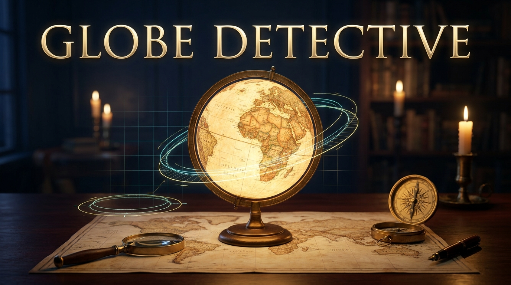

<p align="center">
  
</p>

<h1 align="center">🕵️‍♂️ Globe Detective</h1>
<p align="center">
  <i>An interactive 3D cartographic investigation system to explore, date, and analyze vintage world globes.</i>
</p>

<p align="center">
  
  
  
  
  
  
  
</p>

<p align="center">
  <a href="#-live-demo">Live Demo</a> •
  <a href="#-project-overview">Overview</a> •
  <a href="#-key-features">Key Features</a> •
  <a href="#️-how-it-works">How It Works</a> •
  <a href="#-architecture">Architecture</a> •
  <a href="#-tech-stack">Tech Stack</a> •
  <a href="#-getting-started">Getting Started</a> •
  <a href="#-connect-with-the-author">Author</a>
</p>

---

## 🚀 Live Demo

[](https://globe-detective.netlify.app/)

**Click the badge above or follow this link to explore the live application:**  
👉 [https://globe-detective.netlify.app/](https://globe-detective.netlify.app/)

---

## 📖 Project Overview

**Globe Detective** is an interactive, educational cartographic web platform designed for dating vintage globes through historical territorial borders, geopolitical shifts, and place names.

Spanning over **130 years of geopolitical history (1886–2019)**, the application integrates peer-reviewed historical geospatial datasets (**CShapes 2.0**) into a real-time **Three.js 3D globe**. Users can inspect territorial boundaries across centuries, deduce mystery globe publication dates with a Bayesian date-range estimation engine, compete in daily chronolocation challenges, and climb the global Hall of Cartographers.

The system is deployed on a modern, ultra-low-latency **serverless edge architecture** with Cloudflare Workers and Google Cloud Firestore, operating with zero server maintenance costs (**$0.00/mo**).

---

## ✨ Key Features

- **🌍 3D Interactive Historical Globe:** Built with Three.js and WebGL. Explore historical borders from 1886 to 2019 with realistic topological bump relief, country selection, search, and dynamic camera navigation.
- **🔍 Detective Investigation Desk:** An evidence-based date estimation engine. Input geopolitical observations (e.g., *"USSR exists"*, *"Rhodesia declared independence"*, *"Germany partitioned"*) from a database of **2,100+ historical events** to compute an authoritative date range with confidence scoring and contradiction analysis.
- **🏆 Daily & Practice Mystery Challenges:** Test your historical chronolocation skills. Inspect a randomly seeded or daily mystery globe, guess the year span, and earn accuracy-tiered points (Exact: 100 pts, Close: 80 pts).
- **⚡ Serverless Edge Verification:** All challenge guesses and seeds are evaluated server-side by a **Cloudflare Worker edge backend** using WebCrypto RS256 token verification, ensuring an anti-cheat competitive experience.
- **🏅 Global Hall of Cartographers (Leaderboard):** Real-time All-Time, Weekly, and Monthly leaderboards backed by hardened Cloud Firestore rules and edge reconciliation.
- **🔄 Seamless Cloud Synchronization & Guest Mode:** Play instantly as a guest without signing up. Sign in with Google or Email at any time to automatically reconcile and sync local achievements and challenge scores to the cloud.
- **🎖️ Collectible Detective Badges:** Earn 12 unique detective badges (e.g., *Centennial Sleuth*, *Iron Curtain Whiz*, *Perfectionist*) tracking your case runs, streaks, and historical milestones.

---

## ⚙️ How It Works

The platform connects a responsive client-side interface to an authoritative serverless edge backend:

```
[User Browser]
      │
      ▼
1. User examines 3D Globe & submits guess (e.g., 1961)
      │
      ▼
2. Client sends Firebase JWT + guess payload to Cloudflare Worker
      │
      ▼
[Cloudflare Worker Edge API]
      │
      ├─► Verifies Firebase Auth JWT via Google RS256 JWKS (WebCrypto)
      ├─► Authoritative scoring math computes true year distance & points
      ├─► Executes atomic Firestore REST transaction:
      │       ├─ Writes verified challenge attempt
      │       ├─ Updates user streaks & career points
      │       └─ Updates Global, Weekly & Monthly Leaderboards
      ▼
3. Worker returns verified score badge (HTTP 200)
      │
      ▼
[Client UI]
      └─► Displays verified result, reveals historical span, updates rank
```

---

## 🏗️ Architecture

Globe Detective employs a **hybrid serverless architecture** that operates **100% within free-tier allowances ($0.00/month)**:

| Layer | Technology | Role | Free Tier Limit |
|:---|:---|:---|:---|
| **Frontend** | React 19 + TypeScript + Vite | 3D Visualization, UI state & Hash routing | Unlimited static hosting on Netlify |
| **Edge Backend** | Cloudflare Workers | Authoritative scoring, token validation & transactions | 100,000 requests / day |
| **Database** | Google Cloud Firestore | Private profiles, case archives & public leaderboards | 50,000 reads, 20,000 writes / day |
| **Authentication**| Firebase Auth | Google OAuth & Email/Password sessions | 50,000 monthly active users |

---

## 🛠️ Tech Stack

This project was built using the following core technologies:

| React | TypeScript | Three.js | Vite | Cloudflare | Firebase | Netlify | Vitest |
| :---: | :---: | :---: | :---: | :---: | :---: | :---: | :---: |
|  |  |  |  |  |  |  |  |

---

## 🚀 Getting Started

<details>
<summary><b>Click here for step-by-step instructions to run Globe Detective locally.</b></summary>

### 1. Prerequisites
- **Node.js** `22.x` or later
- **npm** `10.x` or later

### 2. Clone the Repository
```bash
git clone https://github.com/Gargi016/globe-detective.git
cd globe-detective
```

### 3. Install Dependencies
```bash
npm install
```

### 4. Configure Environment Variables (Optional)
The project works immediately in local **Guest Mode** with zero configuration. To enable cloud authentication and edge scoring:
```bash
cp .env.example .env
```
Fill in your Firebase credentials and Cloudflare Worker API URL:
```env
VITE_WORKER_API_URL=https://globe-detective-api.your-account.workers.dev
VITE_FIREBASE_API_KEY=your_api_key
VITE_FIREBASE_AUTH_DOMAIN=your-project.firebaseapp.com
VITE_FIREBASE_PROJECT_ID=your-project-id
VITE_FIREBASE_STORAGE_BUCKET=your-project.firebasestorage.app
VITE_FIREBASE_MESSAGING_SENDER_ID=your_sender_id
VITE_FIREBASE_APP_ID=your_app_id
```

### 5. Start Development Server
```bash
npm run dev
```
Open [http://localhost:5173](http://localhost:5173) in your browser.

### 6. Run Test Suite
```bash
npm test
```
Runs 232 unit, integration, and security rule tests via Vitest.

### 7. Production Build
```bash
npm run build
```
Creates an optimized, production-ready bundle in `dist/`.

</details>

---

## 🤝 How to Contribute

Contributions are welcome! If you are interested in historical cartography, educational gaming, or geospatial visualization, feel free to fork the repository and submit a pull request.

### Areas for Contribution
- **Historical Events Database:** Add new geopolitical events, treaties, and country rename dates to `src/detective/historicalEvents.ts`.
- **Geospatial Datasets:** Enrich historical border resolution and metadata for earlier centuries.
- **3D Graphics & Shaders:** Create custom WebGL atmosphere shaders, day/night terminators, or vintage parchment textures.
- **Accessibility & Localization:** Enhance screen reader support, keyboard navigation, and international translations.

---

## 🔗 Connect with the Author

<p align="left">
  <a href="https://github.com/Gargi016" target="_blank">
    
  </a>
  <a href="https://www.linkedin.com/in/gargi-das-0026b331a" target="_blank">
    
  </a>
</p>
